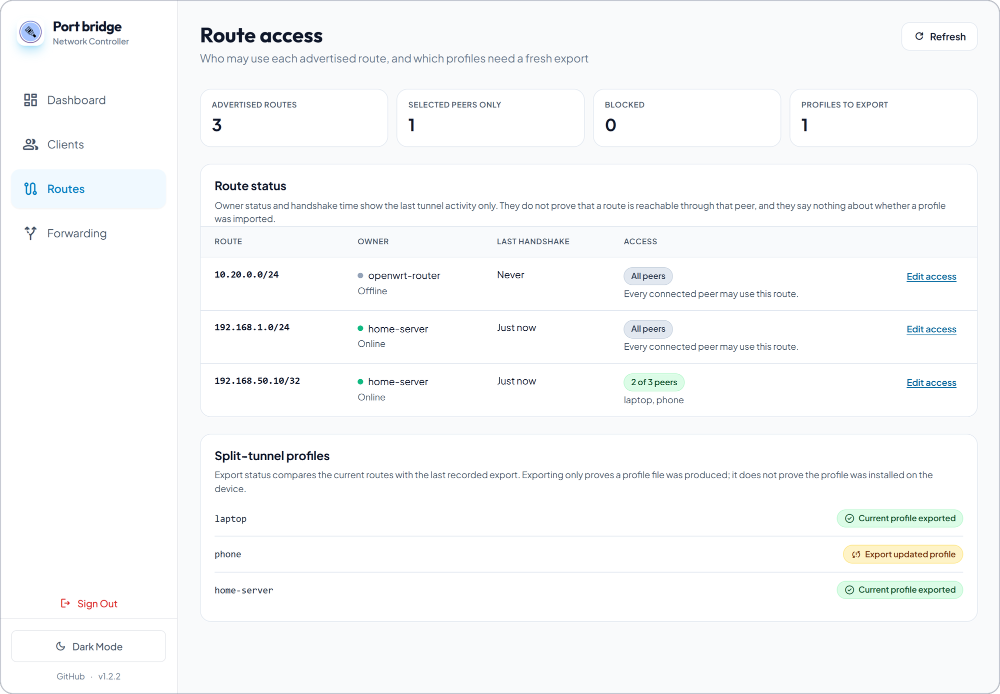
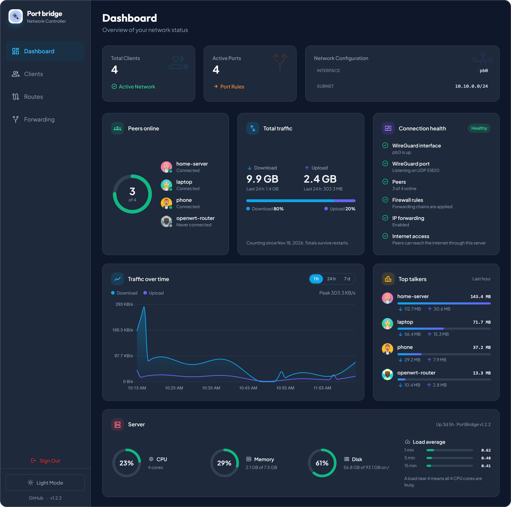
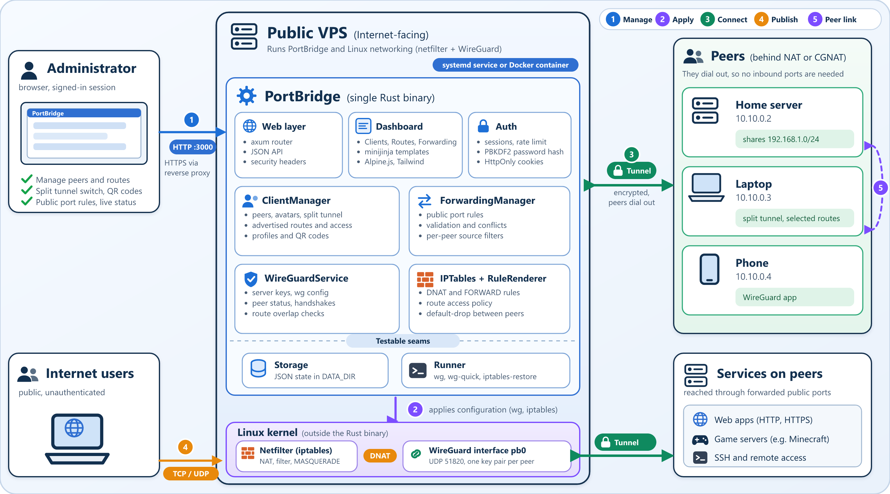

<div align="center">
  

  [](https://portbridge-demo.pages.dev)
  [](https://github.com/nooblk-98/portbridge/releases)
  [](https://github.com/nooblk-98/portbridge/actions/workflows/release.yml)
  [](https://hub.docker.com/r/lahiru98s/portbridge)
  [](https://www.rust-lang.org/)
  [](https://www.wireguard.com/)
  [](LICENSE)
</div>

PortBridge is a single Rust binary that pairs a WireGuard VPN server with iptables port forwarding, managed from a web dashboard. Run it on a public VPS to expose services from home labs, Starlink or other connections that cannot accept inbound traffic. Think of it as a **self-hosted alternative to Tailscale and Headscale**, with public port forwarding built in, that also works as a **bastion (jump) host**.

**Try it now:** the [live demo](https://portbridge-demo.pages.dev) runs the real dashboard with sample data. Any password works, and nothing is saved.

**Jump to:** [Features](#features-and-capabilities) · [Install](#install) · [Update](#update) · [Uninstall](#uninstall) · [Usage](#usage) · [Configuration](#configuration) · [Backup and restore](#backup-and-restore) · [Contributing](#contributing)

## Features and capabilities

**Peers and onboarding**

- Create, rename and delete WireGuard peers from the dashboard. Each peer gets its own key pair and the next free tunnel address, or one you choose.
- Give a device its profile as a `.conf` download or a QR code for the WireGuard app. Downloads are never cached.
- Per-peer settings: DNS servers, MTU (1280 to 9000), keepalive (25 seconds by default, 0 turns it off), and split or full tunnel.
- Tracks which devices still need to import an updated profile, with a banner and a one-click **Imported** confirmation.

**Private networking**

- A hub-and-spoke WireGuard network (default `10.8.0.0/24`). Devices behind NAT or CGNAT dial out, so they need no open inbound port.
- Share a host or subnet from any peer by advertising up to 32 IPv4 routes: the private ranges and `100.64.0.0/10`. Overlaps with the VPN subnet or the server's own routes are refused.
- **Route access control**: each route is open to every peer, limited to the peers you pick, or blocked. Everything else is dropped by the firewall.
- A per-peer **Server access** switch, so Docker containers and reverse proxies on the server, such as Nginx Proxy Manager, can reach that peer's services.

**Public forwarding**

- Publish a TCP port, a UDP port, or both, or a whole port range, on the server and send it to a service on a peer, optionally on a different service port.
- Restrict a rule to a source IP or CIDR.
- Rules are added and removed live, with a confirmation before removal, and each one also shows on its peer's card.

**Dashboard and monitoring**

- Peers online, and when each of the others was last seen.
- Total traffic with a download and upload split, and the last 24 hours.
- Traffic over time for the last hour, 24 hours or 7 days, and the busiest peers.
- Health checks for the WireGuard interface and port, peers, firewall rules, IP forwarding and internet access.
- Server CPU, memory, disk, load average and uptime.

**Good to know**

- It is a hub and spoke, not a mesh: traffic between peers passes through your server, and peers do not connect to each other directly.
- There is one admin login, with no per-user accounts or roles.
- The tunnel network and routes are IPv4, and the server runs Linux with WireGuard and iptables.
- The dashboard is served over plain HTTP, so put it behind an HTTPS reverse proxy.

## Screenshots

<table>
  <tr>
    <td width="50%"><br><sub><b>Clients</b>: avatars, a split tunnel switch, routes and data usage</sub></td>
    <td width="50%"><br><sub><b>Routes</b>: who can use each route and which profiles need exporting</sub></td>
  </tr>
  <tr>
    <td width="50%"><br><sub><b>Forwarding</b>: publish a service on a public port</sub></td>
    <td width="50%"><br><sub><b>Peer settings</b>: routes, access, split tunnel and network options</sub></td>
  </tr>
</table>

<p align="center">
  <br>
  <sub><b>Dark mode</b>: follows your system or your choice</sub>
</p>

## Install

You need a Linux server with a public IP address or DNS name. Allow **UDP 51820** (WireGuard) through its firewall and your provider's, and **TCP 3000** for the dashboard. Any port you publish with a forwarding rule must be open too. WireGuard is built into Linux 5.6 and newer, and the Debian and Ubuntu installer adds `wireguard-tools` for you.

> [!WARNING]
> The dashboard is served over plain HTTP, so your password is sent unencrypted. Put it behind an HTTPS reverse proxy, restrict port 3000 to trusted addresses in your firewall, or bind it to localhost (`APP_HOST=127.0.0.1`, or `"127.0.0.1:3000:3000/tcp"` in Compose) and use an SSH tunnel: `ssh -N -L 3000:127.0.0.1:3000 user@vpn.example.com`.

Pick one way. In every command, use your server's public hostname or IP in place of `vpn.example.com`.

### Install with Docker

Needs Docker Engine with Compose v2. Make a folder, download the Compose file, and give it your server's address and a strong dashboard password:

```sh
mkdir portbridge && cd portbridge
curl -fsSLO https://raw.githubusercontent.com/nooblk-98/portbridge/main/docker-compose-live.yml
printf 'WG_HOST=vpn.example.com\nADMIN_PASSWORD=change-me-to-a-long-password\n' > .env
```

Start it and watch the log:

```sh
docker compose -f docker-compose-live.yml up -d
docker compose -f docker-compose-live.yml logs -f
```

The dashboard is at `http://vpn.example.com:3000`. The image is published for `amd64` and `arm64` on [Docker Hub](https://hub.docker.com/r/lahiru98s/portbridge) and GHCR. The file uses the `latest` tag; to stay on one release, change it to a version tag such as `lahiru98s/portbridge:v1.6.2`. To store a hash instead of the password, set `ADMIN_PASSWORD_HASH` (see [Configuration](#configuration)).

### Install ( Debian or Ubuntu, no Docker )


```sh
curl -fsSL https://raw.githubusercontent.com/nooblk-98/portbridge/main/install.sh | sudo bash -s -- vpn.example.com
```

or

```sh
wget -qO- https://raw.githubusercontent.com/nooblk-98/portbridge/main/install.sh | sudo bash -s -- vpn.example.com
```

To install a specific version, set `PORTBRIDGE_VERSION` on the `sudo` side: `| sudo PORTBRIDGE_VERSION=v1.6.2 bash -s -- vpn.example.com`. Check that it is running:

```sh
sudo systemctl status portbridge
sudo journalctl -u portbridge -e
```

### Build from source

Install `build-essential` and Rust 1.85 or newer, then build the binary and install it with the same script (it uses your binary instead of downloading a release):

```sh
git clone https://github.com/nooblk-98/portbridge.git
cd portbridge
cargo build --release --locked --bin portbridge
sudo PORTBRIDGE_BINARY="$PWD/target/release/portbridge" bash install.sh vpn.example.com
```

To build and run it in Docker instead, run `docker compose up -d --build` in the checkout.

### Your first five minutes

1. Open `http://vpn.example.com:3000` and sign in with the dashboard password.
2. Go to **Clients** and choose **New Client**. Give the device a name.
3. Download its configuration, or scan the QR code with the [WireGuard app](https://www.wireguard.com/install/), and activate the tunnel.
4. Check that the peer shows **Online** with a recent handshake. The dashboard's **Peers online** count goes up.
5. Next, [share a host or subnet](#share-a-host-or-subnet-privately) or [publish a service](#publish-a-service-to-the-internet).

## Update


**Docker.** Run these in the folder with your Compose file. Your peers and keys stay in the `wg-data` volume:

```sh
docker compose -f docker-compose-live.yml pull
docker compose -f docker-compose-live.yml up -d
```

If you pinned a version tag, change it to the new one first.

**Normal install.** The same script with `--upgrade`. It keeps your settings, peers and keys:

```sh
curl -fsSL https://raw.githubusercontent.com/nooblk-98/portbridge/main/install.sh | sudo bash -s -- --upgrade
```


## Uninstall

**Docker.** In the folder with your Compose file:

```sh
docker compose -f docker-compose-live.yml down        # remove PortBridge, keep your peers and keys
docker compose -f docker-compose-live.yml down -v     # also delete the data volume (peers and keys)
```

The same script with `--uninstall`. It removes the service, the program and its settings in `/etc/portbridge`. Your peers and keys stay in `/var/lib/portbridge` unless you add `--purge`:

```sh
curl -fsSL https://raw.githubusercontent.com/nooblk-98/portbridge/main/install.sh | sudo bash -s -- --uninstall
curl -fsSL https://raw.githubusercontent.com/nooblk-98/portbridge/main/install.sh | sudo bash -s -- --uninstall --purge
```

## Usage

### Share a host or subnet privately

1. Open **Clients → Peer settings** for the device that owns or can reach the host.
2. Enter an IPv4 address (`192.168.50.10`) or CIDR (`192.168.50.0/24`) and save.
3. If the destination sits behind that device, enable IP forwarding on it, allow forwarding in its firewall, and add a return route to the WireGuard subnet (or use source NAT).
4. Peers using **Split tunnel** must re-import their updated profile. The dashboard shows a banner listing them, with an **Imported** button so you can track which devices still need it.
5. Open **Routes** and select **Edit access** to choose which peers may use the route. An empty selection blocks every other peer.

The service is **not** exposed to the internet: only peers you allow can reach it, through the tunnel. You can advertise private IPv4 ranges and `100.64.0.0/10`. Routes must be distinct and cannot overlap the VPN subnet or existing server routes.

### Publish a service to the internet

Private access is enough for most services. Publish one only when people outside your VPN must reach it. Open **Forwarding**, create a rule, and choose a public port, protocol, target peer and service port. Optionally restrict it to a source IP or CIDR.

The service sees the original client address, so its replies must return through WireGuard. With a split-tunnel profile, add a return route for the permitted sources, or use a full-tunnel profile. Allow the public port through your firewalls, and for Docker add it to the Compose `ports` list, for example `"30000:30000/tcp"`.

### Reach peers from the PortBridge server

The per-peer **Server access** switch lets Docker containers and other traffic forwarded through the server, such as Nginx Proxy Manager, connect to the services on that peer, so the server can act as a reverse proxy for services behind NAT. It is off by default (set `ALLOW_LOCAL_TO_PEERS=1` to default it on). It controls forwarded traffic only: programs run directly on the server, such as `curl` or `ssh`, are not restricted by it. Point a proxy host at the peer's tunnel address (for example `http://10.10.0.2:8080`) or at a subnet it advertises. Peers can only answer these connections, not start new ones to the server's other services.

### Internet access through the VPN

Peers use split tunneling by default, so a device keeps its own internet connection and public IP. To send all of a device's traffic through the server, turn off **Split tunnel** in that peer's settings and re-import its profile. To forbid this for everyone, set `ALLOW_INTERNET_EGRESS=0`.


## Configuration

PortBridge is configured through environment variables: in `/etc/portbridge/portbridge.env` for a normal install, or the `environment` section of the Compose file. Restart after changing them.

| Variable | Default | Description |
| --- | --- | --- |
| `ADMIN_PASSWORD` | required unless a hash is set | Dashboard password |
| `ADMIN_PASSWORD_HASH` | unset | Salted PBKDF2 hash used instead of `ADMIN_PASSWORD`. Create one with `echo -n 'your-password' \| portbridge hash-password` |
| `WG_HOST` | `127.0.0.1` | Public hostname or IP written into peer configs |
| `WG_PORT` | `51820` | WireGuard UDP port |
| `WG_NETWORK` | `10.8.0.0/24` | VPN subnet |
| `WG_INTERFACE` | `wg0` | WireGuard interface name |
| `APP_HOST` / `APP_PORT` | `0.0.0.0` / `3000` | Dashboard bind address |
| `DATA_DIR` | `/data` | Where keys and state are stored |
| `ALLOW_INTERNET_EGRESS` | allowed | Set to `0` to block peer internet access through the server |
| `UPDATE_CHECK` | on for releases | Set to `0` to stop the dashboard looking for a newer release, for example on an air-gapped server. See [Upgrading](#upgrading) |
| `ALLOW_LOCAL_TO_PEERS` | off | Default for the per-peer **Server access** switch: whether Docker containers and other traffic forwarded through the PortBridge server, such as a reverse proxy, may connect to a peer's services. Set to `1` to make it on by default |
| `ENABLE_IPV4_FORWARDING` | off | Set to `1` to let PortBridge turn on kernel IPv4 forwarding. The installer sets it, and the Compose file sets the sysctl instead |

Advanced settings, which most installs never change:

| Variable | Default | Description |
| --- | --- | --- |
| `WG_ADDRESS` | first address of `WG_NETWORK` | The server's own address inside the VPN, with its prefix, for example `10.8.0.1/24` |
| `WG_CONFIG_PATH` | `/etc/wireguard/<WG_INTERFACE>.conf` | Where the WireGuard config is written. The file name must be `<WG_INTERFACE>.conf` |
| `DEFAULT_CLIENT_NAME` | `default` | Name of the first peer, created on first start |
| `DEFAULT_FORWARD_TARGET` | second address of `WG_NETWORK` | Peer address that the example rule from `SEED_FORWARDING` points to |
| `SEED_FORWARDING` | off | Set to `1` to add an example rule on first start (public port 30000, TCP and UDP, to port 8080 on the default peer). The installer leaves it off |
| `FORWARD_CONFIG` | `DATA_DIR/forwardings.json` | Where forwarding rules are stored |
| `STATIC_DIR` / `TEMPLATE_DIR` | `app/static` / `app/templates` | Where the dashboard's files are. The installer and the Docker image set them up |

## Backup and restore

Everything PortBridge knows is in `DATA_DIR` (`/data` in Docker, `/var/lib/portbridge` for a normal install): the server's WireGuard keys, your peers and their private keys, forwarding rules and traffic history. Back it up, and keep the backup private, because it contains keys.

**Docker:**

```sh
# Back up
docker compose -f docker-compose-live.yml exec -T wg-forwarder tar czf - -C /data . > portbridge-backup.tgz

# Restore (on this or a new server, from the folder with the Compose file)
docker compose -f docker-compose-live.yml run --rm --no-deps -T --entrypoint sh wg-forwarder -c 'tar xzf - -C /data' < portbridge-backup.tgz
docker compose -f docker-compose-live.yml up -d
```

**Normal install:**

```sh
# Back up
sudo tar czf portbridge-backup.tgz -C /var/lib/portbridge .

# Restore (stop the service first, then start it again)
sudo systemctl stop portbridge
sudo tar xzf portbridge-backup.tgz -C /var/lib/portbridge
sudo systemctl start portbridge
```

Also keep a copy of `/etc/portbridge/portbridge.env` (your settings and the password hash) for a normal install, or your `.env` for Docker. Set `WG_HOST` to the new server's address if it changed, and re-import the peers' profiles on their devices.

## How it works

<p align="center">
  
</p>

- **Peers dial out.** Devices behind NAT or CGNAT connect to the server's WireGuard port and keep the tunnel alive, so they need no open inbound port.
- **The server is the hub.** PortBridge writes the WireGuard config and the iptables rules and applies them with `wg`, `wg-quick` and `iptables-restore`.
- **One binary.** An `axum` web server serves the dashboard and JSON API, and state lives in JSON files under `DATA_DIR`.

You have two ways to reach a service, and both are managed from the dashboard. Nothing a peer runs is reachable from the internet unless you decide it should be:

| | Private access (WireGuard peers) | Public forwarding |
| --- | --- | --- |
| **Who can connect** | Only devices you added as peers, and only to routes you approve | Anyone on the internet, or only the source IPs you allow |
| **Exposed to the internet** | No. The service stays on the private tunnel network | Yes, on the public port you choose |
| **How to set it up** | Add a peer, then use **Clients → Peer settings** and **Routes** to share a host or subnet | **Forwarding**: pick a public port, a target peer and a service port |
| **Good for** | SSH, admin panels, databases, NAS, anything you do not want public | Web servers, game servers, anything strangers must reach |

Use private access for everything you can, and add a forwarding rule only for the few services that must be public.

## Where PortBridge fits

PortBridge is a **self-hosted alternative to Tailscale and Headscale** for a common setup: a VPS with a public IP, and devices behind NAT or CGNAT (home labs, Starlink, mobile networks) that must reach each other and be reachable, with no third-party account or hosted control plane. It can replace WireGuard managers such as wg-easy, and tunnels that publish a port such as frp, rathole, ngrok and Cloudflare Tunnel.

It is a **hub and spoke**, not a mesh, which keeps it simple: plain WireGuard configs, one public UDP port and one binary. It can also **publish a public TCP or UDP port** on the server and send it into a peer.

| Choose PortBridge when you want | Choose a mesh tool when you need |
| --- | --- |
| One server you control, with no external account or hosted coordination service | Direct peer-to-peer connections and NAT traversal between peers |
| To publish a service from behind CGNAT on a public port | Sign-in with your identity provider and per-user or per-group policies |
| Plain WireGuard profiles and QR codes that work with any client | Large teams or hundreds of devices |

## Contributing

Pull requests are welcome. To build and test:

```sh
cargo build
cargo test
cd frontend && npm ci && npm test       # script unit tests
npm run test:e2e                         # browser tests (see frontend/README.md)
```

The dashboard is server-rendered templates with Alpine.js and Tailwind CSS. [frontend/README.md](frontend/README.md) explains how the stylesheet is built, how the dashboard script is organised, the browser tests, and `npm run screenshots` for refreshing the images above. See [CONTEXT.md](CONTEXT.md) for the domain language and module overview, and [CHANGELOG.md](CHANGELOG.md) for release notes.

## Security

Please do not report a vulnerability in a public issue. See [SECURITY.md](SECURITY.md).

## License

MIT. See [LICENSE](LICENSE).
