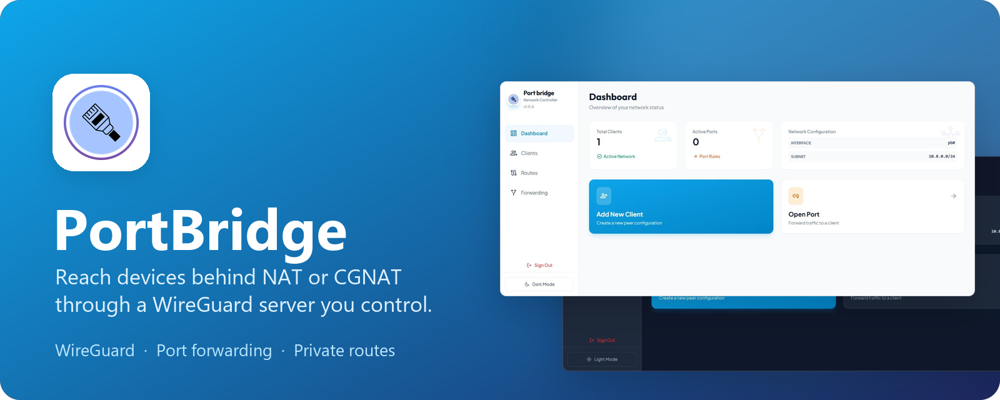
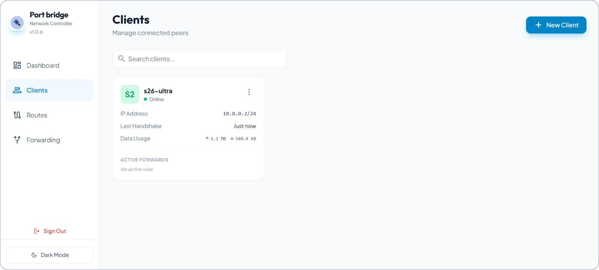
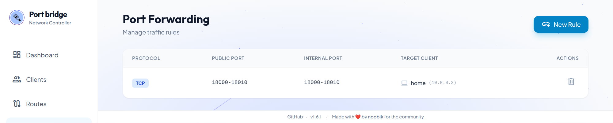
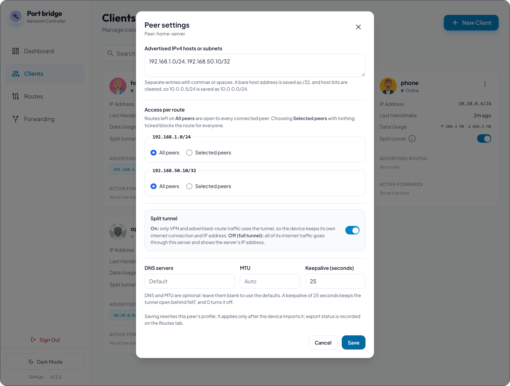

<div align="center">
  

  [](https://github.com/nooblk-98/portbridge/releases)
  [](https://github.com/nooblk-98/portbridge/actions/workflows/release.yml)
  [](https://hub.docker.com/r/lahiru98s/portbridge)
  [](https://www.rust-lang.org/)
  [](https://www.wireguard.com/)
  [](LICENSE)
</div>

PortBridge is a single Rust binary that pairs a WireGuard VPN server with iptables port forwarding, managed from a web dashboard. Run it on a public VPS to expose services from home labs, Starlink or other connections that cannot accept inbound traffic. Think of it as a **self-hosted alternative to Tailscale and Headscale**, with public port forwarding built in, that also works as a **bastion (jump) host**.

- **Private access**: reach services on other peers over WireGuard without exposing them to the internet, with per-route access control.
- **Public forwarding, only when you want it**: publish a TCP or UDP port on the server and send it to a service on a peer, from the same dashboard, with optional source IP restrictions.
- **Live dashboard**: peers online, traffic over time, top talkers, connection health checks, and CPU, memory and disk gauges.
- **Easy onboarding**: create peers in the UI, then download the config or scan a QR code. Each peer gets its own cartoon avatar.
- **Split tunnel by default**: devices keep their own internet connection and IP. Switch a peer to full tunnel from its card when you want its traffic to leave through the server.
- **Safe defaults**: passwords are stored as salted hashes, logins are rate limited, and peers can only reach each other through routes you approve.

**Jump to:** [Features](#features-and-capabilities) · [Quick start](#quick-start) · [Docker Compose](#docker-compose) · [Build from source](#build-from-source) · [Debian or Ubuntu](#debian-or-ubuntu-no-docker) · [Usage](#usage) · [Configuration](#configuration) · [Upgrading](#upgrading)

## Features and capabilities

**Peers and onboarding**

- Create, rename and delete WireGuard peers from the dashboard. Each peer gets its own key pair and the next free tunnel address, or one you choose.
- Give a device its profile as a `.conf` download or a QR code for the WireGuard app. Downloads are never cached.
- Per-peer settings: DNS servers, MTU (1280 to 9000), keepalive (25 seconds by default, 0 turns it off), and split or full tunnel.
- Each peer gets a generated cartoon avatar that survives a rename.
- Tracks which devices still need to import an updated profile, with a banner and a one-click **Imported** confirmation.

**Private networking**

- A hub-and-spoke WireGuard network (default `10.8.0.0/24`). Devices behind NAT or CGNAT dial out, so they need no open inbound port.
- Share a host or subnet from any peer by advertising up to 32 IPv4 routes: the private ranges and `100.64.0.0/10`. Overlaps with the VPN subnet or the server's own routes are refused.
- **Route access control**: each route is open to every peer, limited to the peers you pick, or blocked. Everything else is dropped by the firewall.
- A per-peer **Server access** switch, so Docker containers and reverse proxies on the server, such as Nginx Proxy Manager, can reach that peer's services.
- Works as a bastion (jump) host for machines with no public address.

**Public forwarding**

- Publish a TCP port, a UDP port, or both, or a whole port range, on the server and send it to a service on a peer, optionally on a different service port.
- Restrict a rule to a source IP or CIDR.
- Rules are added and removed live, with a confirmation before removal, and each one also shows on its peer's card.

**Dashboard and monitoring**

- Peers online, and when each of the others was last seen.
- Total traffic with a download and upload split, and the last 24 hours.
- Traffic over time for the last hour, 24 hours or 7 days, and the busiest peers.
- Health checks for the WireGuard interface and port, peers, firewall rules, IP forwarding and internet access.
- Server CPU, memory, disk, load average and uptime.
- A notice when a newer release exists, with its changelog and the upgrade command to copy. Nothing upgrades by itself.

**Security**

- The password is stored as a salted PBKDF2-SHA256 hash (600,000 iterations), or you supply the hash yourself, and it is compared in constant time.
- Server-side sessions that expire, `HttpOnly` cookies, and a login rate limit of 5 attempts a minute.
- A default-deny firewall: between peers and the outside, only established traffic and the routes you approved are allowed. Internet access through the server can be switched off with `ALLOW_INTERNET_EGRESS=0`.
- A Content-Security-Policy that restricts scripts to the dashboard's own files, and authenticated pages and downloads are never cached.
- On Debian or Ubuntu the service runs under a hardened systemd unit (no new privileges, a read-only system), and the installer verifies each release's SHA-256 checksum.

**Install and operate**

- Run the published Docker image, or install natively on Debian or Ubuntu with one command, or build from source. Static x86_64 and arm64 binaries need no Rust toolchain.
- Upgrade or remove with one command (`--upgrade`, `--uninstall`, `--purge`). An upgrade keeps your settings, peers and keys.
- Configured with environment variables only. State is plain JSON files under `DATA_DIR`, so there is no database to run or back up separately.
- Light and dark themes that follow your system or your choice, a layout that works on a phone, and dialogs that trap focus and close with Escape.

**Good to know**

- It is a hub and spoke, not a mesh: traffic between peers passes through your server, and peers do not connect to each other directly.
- There is one admin login, with no per-user accounts or roles.
- The tunnel network and routes are IPv4, and the server runs Linux with WireGuard and iptables.
- The dashboard is served over plain HTTP, so put it behind an HTTPS reverse proxy.

## Private by default, public when you choose

Nothing a peer runs is reachable from the internet unless you decide it should be. You have two ways to reach a service, and both are managed from the dashboard:

| | Private access (WireGuard peers) | Public forwarding |
| --- | --- | --- |
| **Who can connect** | Only devices you added as peers, and only to routes you approve | Anyone on the internet, or only the source IPs you allow |
| **Exposed to the internet** | No. The service stays on the private tunnel network | Yes, on the public port you choose |
| **How to set it up** | Add a peer, then use **Clients → Peer settings** and **Routes** to share a host or subnet | **Forwarding**: pick a public port, a target peer and a service port |
| **Good for** | SSH, admin panels, databases, NAS, anything you do not want public | Web servers, game servers, anything strangers must reach |

Use private access for everything you can, and add a forwarding rule only for the few services that must be public. Both live in the same panel, so you can switch a service from private to public, and back, without touching a firewall by hand.

## Where PortBridge fits

PortBridge is a **self-hosted alternative to Tailscale and Headscale** for a common setup: you have a VPS with a public IP, and you want devices behind NAT or CGNAT, such as home labs, Starlink and mobile networks, to reach each other and be reachable, without a third-party account or hosted control plane.

It covers the same ground as, and can replace, tools such as:

- **VPN and mesh tools**: Tailscale, Headscale, NetBird, Netmaker, ZeroTier, Nebula, and WireGuard managers such as wg-easy.
- **Tunnels that publish a port**: frp, rathole, ngrok, Cloudflare Tunnel and Pangolin.

PortBridge is a **hub and spoke**, not a mesh: every peer connects to your server and traffic between peers passes through it. That keeps it simple, with plain WireGuard configs, one public UDP port and one binary. It also lets PortBridge do something most VPN tools do not: **publish a public TCP or UDP port** on the server and send it into a peer.

| Choose PortBridge when you want | Choose a mesh tool when you need |
| --- | --- |
| One server you control, with no external account or hosted coordination service | Direct peer-to-peer connections and NAT traversal between peers |
| To publish a service from behind CGNAT on a public port | Sign-in with your identity provider and per-user or per-group policies |
| Plain WireGuard profiles and QR codes that work with any client | Large teams or hundreds of devices |

### Use it as a bastion host

Every peer can reach the server, and any peer can share a subnet, so the VPS also works as a **bastion (jump) host** for machines that have no public address.

1. Add your laptop as a peer, and add a machine on the target network (for example a home server) as another.
2. In the home server's **Peer settings**, advertise its network, such as `192.168.1.0/24`, and use **Routes → Edit access** to choose who may use it.
3. With the laptop's tunnel up, reach the network directly, for example `ssh user@192.168.1.20`.

You can also jump through the server's public address with no VPN client on the laptop, because the server can reach every peer's tunnel address:

```sh
ssh -J ubuntu@vpn.example.com user@10.10.0.2
```

> [!TIP]
> Harden the bastion itself: allow SSH with keys only, restrict its firewall, and put the dashboard behind HTTPS or limit port 3000 to trusted addresses.

## Screenshots

<p align="center">
  
</p>

<table>
  <tr>
    <td width="50%"><br><sub><b>Clients</b>: avatars, a split tunnel switch, routes and data usage</sub></td>
    <td width="50%"><br><sub><b>Routes</b>: who can use each route and which profiles need exporting</sub></td>
  </tr>
  <tr>
    <td width="50%"><br><sub><b>Forwarding</b>: publish a service on a public port</sub></td>
    <td width="50%"><br><sub><b>Peer settings</b>: routes, access, split tunnel and network options</sub></td>
  </tr>
</table>

<p align="center">
  <br>
  <sub><b>Dark mode</b>: follows your system or your choice</sub>
</p>

## Architecture

<p align="center">
  
</p>

- **Peers dial out.** Devices behind NAT or CGNAT connect to the server's WireGuard port and keep the tunnel alive, so they need no open inbound port.
- **The server is the hub.** PortBridge generates the WireGuard config and the iptables rules, and applies them with `wg`, `wg-quick` and `iptables-restore`.
- **Private routes and public ports.** Peers reach each other and shared subnets over the hub according to each route's access rules. A forwarding rule sends a public port into the tunnel to a service on a peer.
- **One binary.** An `axum` web server serves the dashboard and JSON API. State lives in JSON files under `DATA_DIR`, and the code behind the `Storage` and `Runner` seams is replaced by fakes in tests.

## Quick start

You need a server with a public IP or DNS name, and UDP 51820 allowed through its firewall and your provider's.

Pick one: [Docker Compose](#docker-compose), [Build from source](#build-from-source), or [Debian or Ubuntu without Docker](#debian-or-ubuntu-no-docker).

### Docker Compose

Create a `.env` file with your server's address and a strong dashboard password:

```ini
WG_HOST=vpn.example.com
ADMIN_PASSWORD=change-me-to-a-long-password
```

Then start the [published image](docker-compose-live.yml):

```sh
docker compose -f docker-compose-live.yml up -d
```

To build from a local checkout instead, run `docker compose up -d --build`.


The dashboard is then available at `http://vpn.example.com:3000`. Allow TCP 3000 through your server and provider firewalls.

> [!WARNING]
> The dashboard is served over plain HTTP, so your password is sent unencrypted. Put it behind an HTTPS reverse proxy, restrict port 3000 to trusted addresses in your firewall, or bind it to localhost (`APP_HOST=127.0.0.1`, or `"127.0.0.1:3000:3000/tcp"` in Compose) and use an SSH tunnel: `ssh -N -L 3000:127.0.0.1:3000 user@vpn.example.com`.

### Build from source

Install `build-essential` and Rust 1.85 or newer, then build the binary and install it with the same script (it uses your binary instead of downloading a release):

```sh
git clone https://github.com/nooblk-98/portbridge.git
cd portbridge
cargo build --release --locked --bin portbridge
sudo PORTBRIDGE_BINARY="$PWD/target/release/portbridge" bash install.sh vpn.example.com
```

To build and run it in Docker instead, use `docker compose up -d --build`. To work on the code, see [Development](#development).

### Debian or Ubuntu (no Docker)

Requires systemd and sudo. Run the installer with your server's public hostname or IP in place of `vpn.example.com`. It downloads the latest release for your architecture (`x86_64` or `arm64`), verifies its SHA-256 checksum, and prompts for a dashboard password. No Rust toolchain is needed.

```sh
curl -fsSL https://raw.githubusercontent.com/nooblk-98/portbridge/main/install.sh | sudo bash -s -- vpn.example.com
```

With `wget`:

```sh
wget -qO- https://raw.githubusercontent.com/nooblk-98/portbridge/main/install.sh | sudo bash -s -- vpn.example.com
```

To pin a version, set `PORTBRIDGE_VERSION` on the `sudo` side, for example `| sudo PORTBRIDGE_VERSION=v1.0.0 bash -s -- vpn.example.com`.

The installer prompts for a dashboard password (16–128 letters or numbers) and stores only a salted hash of it. It creates the `pb0` WireGuard interface, stores data in `/var/lib/portbridge`, and starts the `portbridge` service. The dashboard listens on port 3000 (allow TCP 3000 in your firewall). See the warning above about HTTP.

```sh
sudo systemctl status portbridge
sudo journalctl -u portbridge -e
```

To upgrade to the latest release or remove PortBridge, run the same script with a flag:

```sh
curl -fsSL https://raw.githubusercontent.com/nooblk-98/portbridge/main/install.sh | sudo bash -s -- --upgrade
curl -fsSL https://raw.githubusercontent.com/nooblk-98/portbridge/main/install.sh | sudo bash -s -- --uninstall
```

An upgrade keeps your settings, peers and keys. An uninstall keeps peers and keys in `/var/lib/portbridge` unless you add `--purge`.

## Usage

### Connect a device

1. Sign in and create a peer under **Clients**.
2. Download its WireGuard configuration or scan the QR code with the [WireGuard app](https://www.wireguard.com/install/).
3. Activate the tunnel and check **Clients** for a recent handshake.

### Share a host or subnet privately

1. Open **Clients → Peer settings** for the device that owns or can reach the host.
2. Enter an IPv4 address (`192.168.50.10`) or CIDR (`192.168.50.0/24`) and save.
3. If the destination sits behind that device, enable IP forwarding on it, allow forwarding in its firewall, and add a return route to the WireGuard subnet (or use source NAT).
4. Peers using **Split tunnel** must re-import their updated profile. The dashboard shows a banner listing those peers with an **Imported** button, so you can track which devices still need it. They can then connect to the destination IP directly.

The service is **not** exposed to the internet: only peers you allow can reach it, through the tunnel.

You can advertise private IPv4 ranges and `100.64.0.0/10`. Routes must be distinct and cannot overlap the VPN subnet or existing server routes. DNS, MTU and keepalive can also be set per peer.

Open **Routes** and select **Edit access** to choose which peers may use a route. An empty selection blocks every other peer.

### Publish a service to the internet

Private access is enough for most services. Publish one on the internet only when people outside your VPN must reach it. Open **Forwarding**, create a rule, and choose a public port, protocol, target peer and service port. Optionally restrict it to a source IP or CIDR.

The service sees the original client address, so its replies must return through WireGuard. With a split-tunnel profile, add a return route for the permitted sources, or use a full-tunnel profile. Allow the public port through your firewalls, and for Docker add the port to the Compose `ports` list, for example `"30000:30000/tcp"`.

### Reach peers from the PortBridge server

**Server access** lets Docker containers and other traffic forwarded through the PortBridge server, such as Nginx Proxy Manager, connect to the services running on a peer. That makes the server a reverse proxy for services that live behind NAT. It is off by default and you switch it on per peer. It controls forwarded traffic only: programs run directly on the server, such as `curl` or `ssh` from a shell, are not restricted by it, peers can already reach each other over their tunnel addresses, and forwarded public ports are not affected. Point a proxy host at a peer's tunnel address (for example `http://10.10.0.2:8080`) or at a subnet the peer advertises (for example `http://192.168.1.106:8080`). Peers can only answer these connections. They cannot start new ones to the server's other services.

Each peer has a **Server access** switch on its card and in its settings, so you can allow it for the peers you proxy and leave it off for the rest. Set `ALLOW_LOCAL_TO_PEERS=1` to make it on by default for peers that have not been switched either way.

### Internet access through the VPN

Peers use split tunneling by default: only VPN and advertised-route traffic goes through the tunnel, so a device keeps its own internet connection and public IP. To send all of a device's traffic through the server, turn off **Split tunnel** in that peer's settings and re-import its profile. The server allows this by default. To block this, set `ALLOW_INTERNET_EGRESS=0` in `/etc/portbridge/portbridge.env` (or the Compose service environment) and restart.

## Configuration

PortBridge is configured through environment variables.

| Variable | Default | Description |
| --- | --- | --- |
| `ADMIN_PASSWORD` | required unless a hash is set | Dashboard password |
| `ADMIN_PASSWORD_HASH` | unset | Salted PBKDF2 hash used instead of `ADMIN_PASSWORD`. Create one with `echo -n 'your-password' \| portbridge hash-password` |
| `WG_HOST` | `127.0.0.1` | Public hostname or IP written into peer configs |
| `WG_PORT` | `51820` | WireGuard UDP port |
| `WG_NETWORK` | `10.8.0.0/24` | VPN subnet |
| `WG_INTERFACE` | `wg0` | WireGuard interface name |
| `APP_HOST` / `APP_PORT` | `0.0.0.0` / `3000` | Dashboard bind address |
| `DATA_DIR` | `/data` | Where keys and state are stored |
| `ALLOW_INTERNET_EGRESS` | allowed | Set to `0` to block peer internet access through the server |
| `UPDATE_CHECK` | on for releases | Set to `0` to stop the dashboard looking for a newer release, for example on an air-gapped server. See [Upgrading](#upgrading) |
| `ALLOW_LOCAL_TO_PEERS` | off | Default for the per-peer **Server access** switch: whether Docker containers and other traffic forwarded through the PortBridge server, such as a reverse proxy, may connect to a peer's services. Set to `1` to make it on by default |

## Upgrading

When a newer release is published, the dashboard shows a notice with what changed and the upgrade command, and lets you **Remind me later** (for a day) or **Ignore this version**. Your browser asks GitHub's public releases API (at most every few hours) and sends nothing about your installation. The server never upgrades itself. Set `UPDATE_CHECK=0` to turn the notice off.

See [CHANGELOG.md](CHANGELOG.md) for what changed in each release. On Debian or Ubuntu, use `--upgrade` as shown above. With Docker, pull the new image and recreate the container. Keep the same Compose project name and data volume. If you are upgrading from the earlier Python version, sign in again and recreate legacy public forwards for the intended peers.

## Development

```sh
cargo build
cargo test
```

See [CONTEXT.md](CONTEXT.md) for the domain language and module overview.
